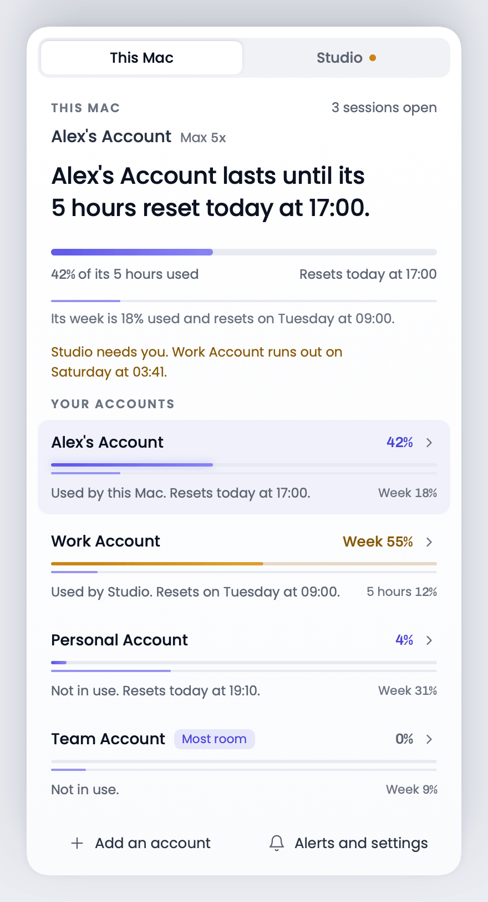
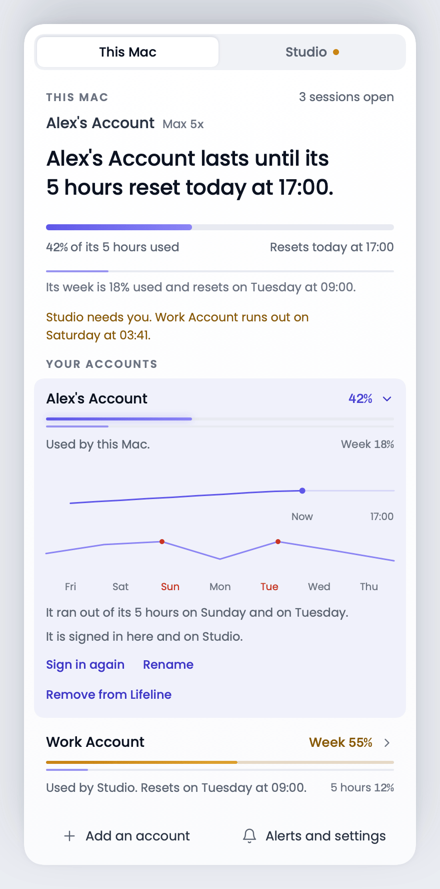
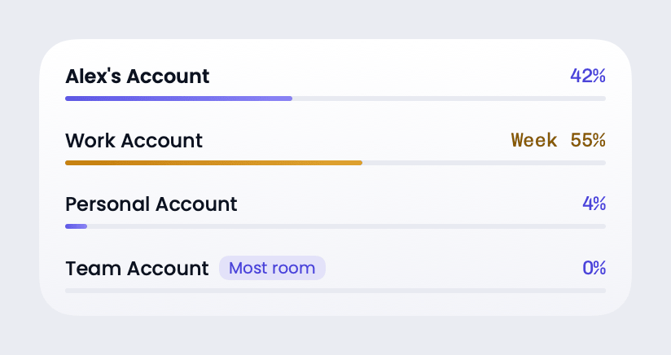
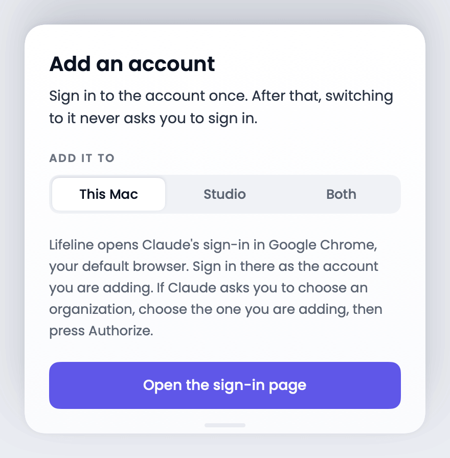
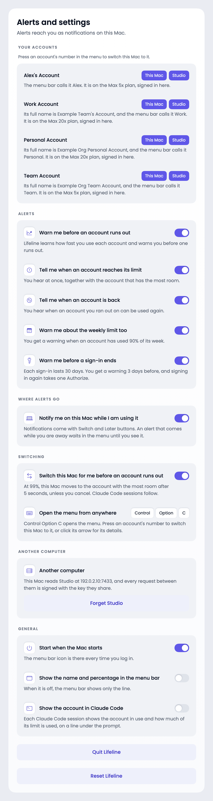

# Lifeline

A Mac menu bar app that shows the use of every Claude account you own and switches Claude Code between them.

<p align="center">
  <picture>
    <source media="(prefers-color-scheme: dark)" srcset="docs/images/menu-dark.png">
    
  </picture>
</p>

Lifeline is for people who use Claude Code with more than one Claude account of their own. It shows each account's 5-hour and weekly use and forecasts when one will run out. It switches Claude Code on the Mac to another account, by hand or on its own. It can also read the accounts Claude Code uses on one other computer, Linux or Mac.

Lifeline is not made by, affiliated with or endorsed by Anthropic. Claude and Claude Code are Anthropic's products.

> [!IMPORTANT]
> Use Lifeline only with accounts you own, and follow [Anthropic's terms](https://www.anthropic.com/legal/consumer-terms) for each one. Do not share accounts with other people. Each account keeps its own usage limits, and Lifeline does not change them. It shows them and moves Claude Code between your accounts.

## Contents

1. [What it does](#what-it-does)
2. [How switching works](#how-switching-works)
3. [Requirements](#requirements)
4. [Install from source](#install-from-source)
5. [Add an account](#add-an-account)
6. [Add another computer](#add-another-computer)
7. [Privacy and security](#privacy-and-security)
8. [Known limits](#known-limits)
9. [FAQ](#faq)
10. [Uninstall](#uninstall)
11. [Contributing](#contributing)
12. [Licence](#licence)

## What it does

1. Live use for every account: the 5-hour window and the week, read from Anthropic and from Claude Code's status line.
2. Run-out forecasts. Lifeline learns how fast you use each account and says when one will run out at that pace, or that it lasts until its reset.
3. Switching that moves your open Claude Code sessions to the new account, with no restart.
4. Auto-switch at 99%. When the account in use reaches 99% of its limit, Lifeline waits 5 seconds, then moves Claude Code to the account with the most room. You can cancel it, undo it or turn it off.
5. Mac notifications, with Switch and Later buttons. Lifeline notifies you before an account runs out, when it reaches its limit and when it is back. It also notifies you at 90% of a week and 3 days before a sign-in ends.
6. Desktop widgets in small, medium and large sizes.
7. An optional second computer. Lifeline reads that computer's accounts too, keeps their sign-ins and adds accounts to it from the Mac.
8. A Claude Code status line, if you turn it on, with the account in use and its figures under the prompt.
9. Remove from Lifeline for one account, and Reset Lifeline to go back to the first run. Neither touches Claude Code's own sign-in.
10. The `lifeline` command, with the same actions in the terminal. `bin/lifeline help` lists them.

Click an account's arrow to open its row. It shows what the account has used, when it resets, and charts of the current 5-hour window and the last 7 days.

<p align="center">
  <picture>
    <source media="(prefers-color-scheme: dark)" srcset="docs/images/open-row-dark.png">
    
  </picture>
  <picture>
    <source media="(prefers-color-scheme: dark)" srcset="docs/images/widget-dark.png">
    
  </picture>
</p>

## How switching works

A small Python service (`core/`) does the work. The Swift app (`app/`) only draws what the service says, and every sentence you see comes from the service.

When you switch to an account, Lifeline:

1. Takes the same storage lock Claude Code takes, so the two never write at the same time.
2. Puts the account's saved sign-in into Claude Code's keychain item, `Claude Code-credentials`, in your login keychain.
3. Writes the account into `~/.claude.json`, where Claude Code names the account in use (`oauthAccount`). It keeps the newest 10 copies of the file from before each switch.
4. Updates the timestamp of `~/.claude/.credentials.json`, so open Claude Code sessions read the new sign-in.
5. Watches for 10 minutes so the switch holds.

The status line, if you turn it on, is a command Lifeline adds to `~/.claude/settings.json`. Claude Code passes it the use figures for the account in use, so Lifeline gets fresh readings from every session. You see the account under the prompt. Turning it off puts back the entry you had before.

## Requirements

1. macOS 14 or newer, with Xcode or the Command Line Tools (Swift 6).
2. Python 3.13 or newer as `python3`, for example from python.org or Homebrew. Lifeline uses no outside packages.
3. Claude Code, signed in to one of your accounts.

For another computer: Linux with systemd, or a Mac, with Python 3.13 or newer and Claude Code.

## Install from source

Clone this repository, then run these two commands in its folder:

```sh
swift build --package-path app
bash scripts/bundle.sh
```

`bundle.sh` makes `build/Lifeline.app` with the service inside it. Copy it to `/Applications` or to Applications in your home folder, then open it. An ad hoc build is not notarized, so the first time, Control-click it and choose Open.

Lifeline starts its service and offers to add the account Claude Code uses now.

Settings for `bundle.sh`:

1. `LIFELINE_BUNDLE_ID` sets the bundle id. The default is `com.example.lifeline`.
2. `LIFELINE_SIGN_IDENTITY` names a signing identity from your keychain and turns on the hardened runtime. Without it the app is signed ad hoc.
3. `LIFELINE_TEAM_ID` adds the desktop widgets. The widgets need a real signing identity and share the app group `TEAMID.BUNDLEID` with the app.
4. `bash scripts/bundle.sh --out FOLDER` builds into `FOLDER` instead of `build/`.

Lifeline names everything it owns from its bundle id, such as its data folder, log folder and keychain service. Two copies with different bundle ids share nothing except Claude Code's own keychain item and `~/.claude.json`.

## Add an account

Choose Add account in the menu. Lifeline opens Claude's own sign-in page in your browser, and you press Authorize. Lifeline never sees your password.

<p align="center">
  <picture>
    <source media="(prefers-color-scheme: dark)" srcset="docs/images/add-account-dark.png">
    
  </picture>
</p>

To see the account and its use under the Claude Code prompt, turn on Show the account in Claude Code in Alerts and settings.

<p align="center">
  <picture>
    <source media="(prefers-color-scheme: dark)" srcset="docs/images/settings-dark.png">
    
  </picture>
</p>

## Add another computer

1. Copy this folder to the other computer, Linux with systemd or a Mac, and run `bash devbox/install.sh` there as your own user. On Linux it installs a systemd user service. On a Mac it installs a launchd agent that uses the keychain like Claude Code does.
2. It prints that computer's address and a one-time pairing code. The code works once, within an hour. For a new one, run the install again or `~/.local/share/com.example.lifeline/app/lifeline pair`.
3. On the Mac, open Alerts and settings, enter the address and the code under Another computer, and press Add a computer.
4. The menu then shows that computer by its name, and you can add accounts to it from the Mac.

The Mac must reach port 7433 on that address, on the same network or over a VPN such as Tailscale. `bash devbox/install.sh --port 7500` uses another port. Lifeline there listens only on the address it printed. `--listen ADDRESS` picks another address, and `--listen 0.0.0.0` opens the port on every network the computer joins, so use that only on networks you trust.

On Linux a sign-in needs a systemd user session, so in a container or WSL without systemd Lifeline reads accounts but cannot sign in.

To stop it, run `bash devbox/install.sh --remove` there. Forget, in the same settings row on the Mac, unpairs the Mac and tells the other computer to drop the key.

## Privacy and security

1. Everything stays on your computers. Lifeline has no telemetry, no account of its own and no server. It talks only to Anthropic, to read each account's profile and use (`api.anthropic.com`) and to renew sign-ins (`platform.claude.com`), and to your paired computer.
2. Saved sign-ins sit in your login keychain, under a service named from the bundle id. Every keychain call names the login keychain, so a lookup never reaches another keychain. A sign-in goes on a command line only in the one case in Known limits, item 8.
3. On Linux, saved sign-ins and the pairing key sit in files only your account can read (mode 600) in `~/.config/com.example.lifeline`.
4. Pairing is signed. The one-time code signs a key exchange, so someone who records the pairing and sees the code later still cannot work out the key. Every request and reply between the two computers is signed with that key, and the other computer refuses anything unsigned, changed, old or repeated.
5. Lifeline never sends a saved sign-in to the other computer. Each computer keeps its own.
6. The menu bar app talks to the service over a local socket that only your account can open.

To report a security problem, see [SECURITY.md](SECURITY.md).

## Known limits

1. Lifeline depends on Claude Code details that are not documented. A Claude Code release can change them, and then switching or readings stop until a new Lifeline follows those changes.
2. It switches Claude Code only on the Mac. On the other computer it reads use, keeps sign-ins and adds accounts, but you switch there yourself.
3. It reads one other computer.
4. The link to the other computer is signed but not encrypted, so account names, emails and use figures cross the network in plain text. Use a network you trust or a VPN.
5. On a Mac used as the other computer, macOS may ask once to let Python read the keychain and accept incoming connections.
6. Any program you run can read Lifeline's keychain items without a prompt, because macOS trusts `/usr/bin/security`, which made them. Claude Code's own item works the same way.
7. Some secrets sit in plain files that only your account can read. On Linux these are every saved sign-in and the pairing key. On both systems, a renewed sign-in waits in the data folder until Lifeline settles it. The copies of `~/.claude.json` can hold MCP server secrets too. Backup and sync tools copy all of these, so keep backups encrypted.
8. When Claude Code's keychain item grows past 4 KB, for example with several MCP server sign-ins, it is too long for `security -i`. Lifeline then gives it to `/usr/bin/security` on its command line for the moment of the write, which is what Claude Code does for the same item. A program running as you or as root can see it in that moment. Lifeline 1.0.0 wrote it through the Security framework instead, but macOS then let only Python read the item, so every read by Claude Code asked for your keychain password.
9. The wording is English only, and times use the 24-hour clock.

## FAQ

### Does Lifeline get around usage limits?

No. Each account keeps its own limits, set by its plan. Lifeline shows how much of each account you have used and moves Claude Code between accounts you own.

### Can I use it to share an account with my team?

No. Do not share accounts. Lifeline is for one person's own accounts.

### Is Lifeline made by Anthropic?

No. It is an independent open-source project, and it is not affiliated with Anthropic.

### What does Lifeline change in Claude Code?

It changes four things:

1. Claude Code's keychain item.
2. The `oauthAccount` entry in `~/.claude.json`.
3. The timestamp of `~/.claude/.credentials.json`.
4. The status line entry in `~/.claude/settings.json`, if you turn it on.

It saves a copy of `~/.claude.json` before each switch and a copy of `settings.json` before each change.

### Does it send my data anywhere?

No. There is no telemetry. The only network calls go to Anthropic's own routes, which Claude Code uses too, and to your paired computer.

### How do I remove an account or start over?

Open the account's row and choose Remove from Lifeline. To start over, choose Reset Lifeline at the end of Alerts and settings. Reset saves a copy of the history and settings beside the data folder first. In the terminal, `lifeline remove 2` and `lifeline reset` do the same. Claude Code keeps its own sign-in either way.

### Does it run on Linux or Windows?

The menu bar app runs on macOS only. A Linux computer can be the other computer that Lifeline reads. Windows is not supported.

## Uninstall

On the Mac:

1. In Alerts and settings, turn the status line off. This puts your previous status line back in `~/.claude/settings.json`. A copy of the file from before each change sits beside it as `settings.json.lifeline-backup-DATE`.
2. Choose Forget under Another computer if you added one.
3. Quit Lifeline from its menu and move Lifeline.app to the Trash.
4. To remove what it kept, delete `~/Library/Application Support/com.example.lifeline`, which holds the copies of `~/.claude.json` too, and `~/Library/Logs/com.example.lifeline`. Saved sign-ins and the pairing key sit in Keychain Access under the service name `com.example.lifeline`. Delete them there if you want them gone.

On the other computer:

1. Run `bash devbox/install.sh --remove` from the same folder. It stops and removes the service and keeps your accounts and sign-ins.
2. To remove everything else, delete `~/.local/share/com.example.lifeline` and `~/.config/com.example.lifeline`. On a Mac, delete the saved sign-ins and the pairing key in Keychain Access the same way.

## Contributing

Bug reports and pull requests are welcome. [CONTRIBUTING.md](CONTRIBUTING.md) explains how to build Lifeline, run both test suites and keep tests away from your real keychain.

## Licence

Lifeline
Copyright (C) 2026 Derrick S. K. Siawor

This program is free software: you can redistribute it and/or modify it under the terms of the GNU General Public License as published by the Free Software Foundation, version 3 of the License.

This program is distributed in the hope that it will be useful, but WITHOUT ANY WARRANTY; without even the implied warranty of MERCHANTABILITY or FITNESS FOR A PARTICULAR PURPOSE. See the GNU General Public License for more details.

You should have received a copy of the GNU General Public License along with this program, in the file LICENSE. If not, see https://www.gnu.org/licenses/.

The fonts in app/Resources/Fonts (Poppins and Chivo Mono) are licensed under the SIL Open Font License, Version 1.1. Their licence texts are in OFL-Poppins.txt and OFL-ChivoMono.txt in that folder.
